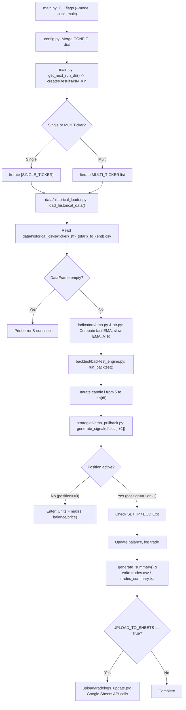
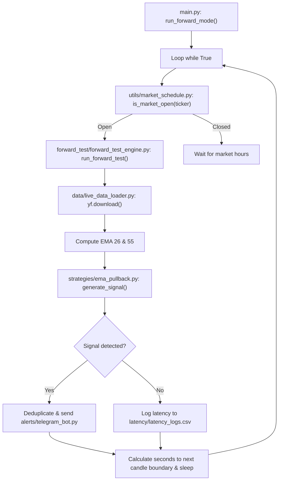
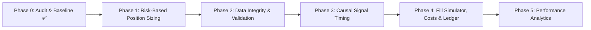

# Trading Engine --- Phase 0 Implementation Audit

**Date:** 2026-11-20  
**Status:** Complete  
**Author:** Lead Quant Developer & Software Architect (Antigravity)  
**Target Repository:** https://github.com/Aryanwadhwa14/Trading_Engine  
**Current Git Commit:** `cc5546c` (Branch: `main`)

---

## 1. Executive Summary & Audit Scope

This document establishes the **Phase 0 audit and reproducible baseline** as mandated by `Docs_stuff/system_design.md` and `Docs_stuff/phases.md`.

The repository was built as an EMA-based algorithmic trading research project with backtesting, live signal scanning with Telegram alerts, and Google Sheets synchronization. The goal of this audit is to inspect the current codebase, verify real execution flows against documented claims, detect critical quant/reproducibility/security issues, introduce a deterministic test scaffold, and formulate the exact plan for Phase 1.

### Key Audit Findings at a Glance
1. **Position Sizing Risk:** Sizing is hardcoded to `max(1, int(balance / entry_price))`, allocating ~100% of available account equity to every trade. `RISK_PERCENT` in `config.py` is completely unused.
2. **Look-Ahead & Signal Timing Inconsistency:** Scalp strategies (S3/S4) evaluate patterns using completed candles but fill at the `open` of the signal bar (retroactive execution in past time). Trend strategies (S1/S2) execute at the signal bar's `close` on the exact same bar with zero latency or fill delay.
3. **Absence of Transaction Costs:** Zero commissions, zero exchange fees, and zero slippage are simulated.
4. **Multi-Ticker Capital Double-Counting:** Backtesting across multiple tickers iterates sequentially while resetting capital to `INITIAL_BALANCE` ($10,000) for every ticker, rather than managing a unified multi-asset portfolio.
5. **Coupled Network Side Effects:** Backtest completion automatically attempts to write to Google Sheets via `gspread` unless `UPLOAD_TO_SHEETS` is manually disabled in `config.py`.
6. **Data Loader Rigidity:** `config.py` dynamically computes start and end dates relative to `datetime.now()`, causing `load_historical_data` to fail to locate fixed-date historical CSV files on disk.
7. **Security Exposure in Git History:** `.env` was committed in historical commits (`c4f5c856` and `99470220`) and deleted in `650812a9`. Secrets existed in tracked history.
8. **Zero Test Coverage:** Prior to this audit, no automated test suite or test runner existed in the repository.

---

## 2. Git Status & Repository Hygiene

### Git Status Inspection
- **Branch:** `main` (synchronized with `origin/main` at `cc5546c`).
- **Unstaged Changes (Pre-existing):**
  11 historical CSV files in `data/historical_csvs/` were deleted from the local working tree:
  - `data/historical_csvs/AAPL_5m_2025-05-04_to_2026-05-04.csv`
  - `data/historical_csvs/AXP_5m_2025-05-04_to_2026-05-04.csv`
  - `data/historical_csvs/CVX_5m_2025-05-04_to_2026-05-04.csv`
  - `data/historical_csvs/JPM_5m_2025-05-04_to_2026-05-04.csv`
  - `data/historical_csvs/MSFT_5m_2025-05-04_to_2026-05-04.csv`
  - `data/historical_csvs/NVDA_5m_2025-05-04_to_2026-05-04.csv`
  - `data/historical_csvs/Polygon_nvda.csv`
  - `data/historical_csvs/SNDK_5m_2025-05-04_to_2026-05-04.csv`
  - `data/historical_csvs/SNXX_5m_2025-05-04_to_2026-05-04.csv`
  - `data/historical_csvs/TSLA_5m_2025-05-04_to_2026-05-04.csv`
  - `data/historical_csvs/backtest_Nvda(yfinance).csv`
- **Untracked Documentation & Test Files:**
  - `Docs_stuff/phases.md`
  - `Docs_stuff/system_design.md`
  - `tests/` (introduced as part of Phase 0 test scaffold)

### Secret Exposure & Repository Hygiene
- **Historical Git Commits Containing `.env`:**
  - `c4f5c8565cb6f1777c5e7f2ea3c92926835cc834` (Author: Aryan Wadhwa, 2026-03-12)
  - `994702206f38370c7433041fc2752ca592266f83` (Author: Kshitij Chaturvedi, 2026-04-29)
  - Deleted in `650812a9476f3b0945f6813a6ee4298f23493e9b` (Author: Kshitij Chaturvedi, 2026-04-30).
  > [!WARNING]
  > Historical credentials (such as `POLYGON_API_KEY`, `TELEGRAM_BOT_TOKEN`, and `GOOGLE_SERVICE_ACCOUNT_JSON`) previously committed to Git history should be considered compromised and rotated immediately.
- **Current State:** `.env` is ignored by `.gitignore`.
- **Ignored Artefacts:** `results/` and `latency/` are ignored in `.gitignore`. However, several historical run folders (`02_run`, `03_run`, `04_run`, `08_run`, `09_run`) remain on disk locally.
- **Dead Code / Stubs:** `plots/plot_engine.py` is empty (0 bytes). `test.py` is an ad-hoc yfinance downloader script rather than an actual test suite.

---

## 3. Actual Runtime Flow Tracing

### 3.1 Backtest Execution Flow (`main.py --mode backtest`)


### 3.2 Forward Scanner Flow (`main.py --mode forward`)


---

## 4. Documented vs. Implemented Feature Matrix

| Feature Domain | Feature Description | In Documentation | In Source Code | Reality & Status |
|---|---|---|---|---|
| **Data** | Local CSV loader from Polygon downloads | Yes | Yes (`data/historical_loader.py`) | Implemented, but rigid naming format binds to dynamic dates. |
| **Data** | Live candle downloader via yfinance | Yes | Yes (`data/live_data_loader.py`) | Implemented with dynamic burn-in calculation. |
| **Data** | Polygon.io bulk downloader | Yes | Yes (`data/download_polygon_data.py`) | Implemented with rate limiting (13s sleep). |
| **Data** | Canonical schema validation & data cleaning | Yes (`system_design.md`) | Partial | Only basic column check and dropna in live loader; no validation in historical loader. |
| **Indicators** | EMA (fast & slow) | Yes | Yes (`indicators/ema.py`) | Uses `ewm(span=period, adjust=False).mean()`. |
| **Indicators** | ATR (volatility) | Yes | Yes (`indicators/atr.py`) | Rolling mean of true range. Note: NaN shift bug on row 0. |
| **Strategy** | EMA Pullback (S1 Trend Long, S2 Trend Short) | Yes | Yes (`strategies/ema_pullback.py`) | S1/S2 trigger on EMA break after pullback. |
| **Strategy** | EMA Scalp (S3 Scalp Short, S4 Scalp Long) | Yes | Yes (`strategies/ema_pullback.py`) | S3/S4 trigger on 3 exhaustion candles. |
| **Risk** | Risk-based position sizing (`RISK_PERCENT`) | Claimed in README | **No** | Uses 100% account balance (`max(1, int(balance / entry_price))`). |
| **Risk** | Portfolio exposure & daily loss limits | Yes (`system_design.md`) | **No** | Completely absent. Planned for Phase 6. |
| **Execution** | Causal next-bar fill simulation | Yes (`system_design.md`) | **No** | Same-bar close fill (S1/S2) or retroactive open fill (S3/S4). |
| **Execution** | Transaction costs (fees & slippage) | Yes (`system_design.md`) | **No** | 0% commission, 0 slippage. |
| **Portfolio** | Multi-asset shared portfolio ledger | Claimed in README | **No** | Independent runs with duplicate capital per ticker. |
| **Forward Testing**| Persistent paper broker / order ledger | Claimed in README | **No** | Real-time scanner + Telegram alert only; no order lifecycle. |
| **Reporting** | Per-strategy CSV and summary text files | Yes | Yes (`backtest/backtest_engine.py`) | Implemented under `results/NN_run/`. |
| **Cloud Sync** | Google Sheets upload of trade logs & summary | Yes | Yes (`upload/tradelogs_update.py`) | Implemented via `gspread`. |
| **Alerts** | Telegram signal dispatch | Yes | Yes (`alerts/telegram_bot.py`) | Implemented via HTTP requests. |
| **ML Engine** | Causal feature extraction & ML baselines | Yes (`system_design.md`) | **No** | Planned for Phase 8. |
| **Tests** | Automated unit and integration test suite | Required by contract | **No** | Missing prior to Phase 0 scaffold. |

---

## 5. In-Depth Technical & Quant Analysis

### 5.1 Position Sizing & Capital Allocation
In `backtest/backtest_engine.py` (line 57):
```python
# Maximizing profit by using all available capital
units = max(1, int(balance / entry_price)) if entry_price > 0 else 1
```
- **Finding:** Sizing uses total current cash divided by entry price. If `balance = $10,000` and `entry_price = $280`, `units = 35` (total nominal exposure = $9,800).
- **Consequence:** `RISK_PERCENT = 0.01` in `config.py` is dead code. The system takes maximum leverage/exposure per trade, which drastically distorts real strategy drawdowns and violates risk-first quant principles.
- **Boundary Failure:** `max(1, ...)` forces at least 1 share even if `balance` drops below the price of 1 share, generating synthetic margin or un-funded positions.

### 5.2 Look-Ahead Risk & Signal Timing Inconsistency
In `strategies/ema_pullback.py` vs `backtest/backtest_engine.py`:
- **Scalp Strategies (S3 & S4):**
  Signal is evaluated at index `i` (using candles `i-3`, `i-2`, `i-1`, and `i`). However:
  ```python
  entry = open  # open of candle i
  ```
  In `backtest_engine.py`, the trade entry price is assigned `signal["entry"]` (the open of candle `i`), while the signal could only be confirmed after observing the body or close of candle `i`. This is a classic **look-ahead / time-travel fill**: the simulator buys/sells at 09:30:00 using information formed between 09:30:00 and 09:35:00.
- **Trend Strategies (S1 & S2):**
  ```python
  entry = close  # close of candle i
  ```
  The trade is simulated as filled at the exact closing price of candle `i` with no execution delay and no slippage, assuming instantaneous zero-latency fills at the exact bar close.

### 5.3 Execution Costs & Market Realism
- **Commissions & Fees:** Not modeled ($0.00). In reality, SEC fees, FINRA TAF, and broker commissions significantly erode returns on high-frequency 5-minute bars.
- **Slippage:** Not modeled (0 bps). In volatile breakout setups (such as S1/S2 breaking EMAs), market orders experience adverse execution slippage.
- **Stop Loss vs. Take Profit Intrabar Race Condition:**
  In `backtest_engine.py`:
  ```python
  if low <= stop_loss or high >= take_profit:
      exit_price = stop_loss if low <= stop_loss else take_profit
  ```
  If both `low <= stop_loss` and `high >= take_profit` occur in the same 5-minute candle, the code unconditionally assigns `exit_price = stop_loss`. While this avoids optimistic target bias, it ignores gaps where the candle opened below `stop_loss`.

### 5.4 Data Pipeline & Date Range Dynamics
- In `config.py`:
  ```python
  end_date = datetime.now()
  start_date = end_date - timedelta(days=30)
  ```
- In `data/historical_loader.py`:
  ```python
  filename = f"{ticker}_{interval}_{start}_to_{end}.csv"
  filepath = os.path.join(current_dir, "historical_csvs", filename)
  ```
- **Flaw:** Because `datetime.now()` advances continuously, `START_DATE` and `END_DATE` shift every day. Unless data is re-downloaded from Polygon daily, `load_historical_data` fails with:
  `❌ Error: Could not find historical data file for {ticker}.`

### 5.5 Indicator Math Bug (`indicators/atr.py`)
In `indicators/atr.py`:
```python
tr = np.maximum(
    df["high"] - df["low"],
    np.maximum(
        abs(df["high"] - df["close"].shift(1)),
        abs(df["low"] - df["close"].shift(1))
    )
)
atr = tr.rolling(period).mean()
```
- **Finding:** At row 0, `df["close"].shift(1)` is `NaN`. In NumPy, `np.maximum(value, np.nan)` yields `np.nan`. Consequently, `tr[0]` is `NaN`.
- In pandas rolling window with default `min_periods=period`, any window containing `tr[0]` evaluates to `NaN`. Therefore, for `period=14`, rows 0 through 13 are `NaN`, and row 14 is the first valid value (14 NaNs). In a standard Wilder ATR or corrected rolling ATR, row 0 uses `high - low`, yielding valid ATR starting at row `period - 1`.

---

## 6. Environment & Dependency Audit

### Package Managers
The repository maintains both `pyproject.toml` (managed by `uv`) and `requirements.txt`:
- `requirements.txt` contains: `numpy`, `pandas`, `yfinance`, `requests`, `python-dotenv`, `gspread`, `google-auth`, `tenacity`, `polygon-api-client`.
- `pyproject.toml` contains: `loguru`, `numpy`, `pandas`, `python-dotenv`, `requests`, `yfinance`, `gspread`, `google-auth`, `tenacity`.
- **Divergence:** `polygon-api-client` is in `requirements.txt` but omitted from `pyproject.toml`. `loguru` is in `pyproject.toml` but omitted from `requirements.txt`.
- `pytest` was not listed in either file.

### Python Runtime
- System Python: Python 3.13.5 (contains `pytest 9.2.0`, `pandas`, `numpy`).
- Local `.venv`: Python 3.13 virtual environment with project dependencies.
- **Pathlib Warning in Global Site-Packages:** An obsolete backport of `pathlib.py` in global site-packages references `from collections import Sequence` (deprecated in Python 3.10+). Direct execution of system python tools must avoid importing the legacy backport.

---

## 7. Baseline Execution & Verification Results

### 7.1 Automated Test Suite Execution
A test scaffold was created under `tests/` with:
- `tests/conftest.py`: Deterministic 30-candle 5-minute OHLCV fixture with known prices and timestamps.
- `tests/test_baseline.py`: Unit tests validating fixture invariants, EMA computation, ATR computation, candle classification helpers, and short DataFrame edge cases.

**Execution Command:**
```powershell
python -m pytest tests -v
```
**Outcome:**
```text
============================= test session starts =============================
platform win32 -- Python 3.13.5, pytest-9.2.0, pluggy-1.7.0
rootdir: D:\Aryan\Trading-engine
configfile: pyproject.toml
collected 5 items

tests/test_baseline.py::test_deterministic_fixture_structure PASSED      [ 20%]
tests/test_baseline.py::test_calculate_ema PASSED                        [ 40%]
tests/test_baseline.py::test_calculate_atr PASSED                        [ 60%]
tests/test_baseline.py::test_candle_helpers PASSED                       [ 80%]
tests/test_baseline.py::test_generate_signal_short_df PASSED             [100%]

============================== 5 passed in 0.31s ==============================
```

### 7.2 Baseline Workflow Execution
**Execution Command:**
```powershell
.\.venv\Scripts\python.exe main.py --mode backtest
```
**Outcome:**
```text
 Running BACKTEST...


--- Backtesting for NVDA ---

❌ Error: Could not find historical data file for NVDA.
Please run 'python data/download_polygon_data.py' first to generate: D:\Aryan\Trading-engine\data\historical_csvs\NVDA_5m_2026-10-21_to_2026-11-20.csv
❌ No data loaded for NVDA. Check ticker/timeframe.
```
**Finding:** Command completed without uncaught exceptions, but could not backtest because:
1. `data/historical_csvs/` CSVs are marked deleted in the git working tree.
2. The dynamic 30-day date calculation in `config.py` looked for a file dated `2026-10-21_to_2026-11-20`, whereas historical data files were dated `2025-05-04_to_2026-05-04`.

---

## 8. Prioritized Roadmap & Recommendations



### Priority 1: Correctness Fixes
1. **Phase 1: Risk-Based Position Sizing:** Replace `max(1, int(balance / entry_price))` with deterministic fractional equity risk sizing based on `RISK_PERCENT`, account equity, and stop-loss distance.
2. **Phase 2: Data Integrity & Fixed Test Windows:** Decouple historical backtesting dates from `datetime.now()` to guarantee reproducible backtest runs. Fix `tr[0]` NaN calculation in `indicators/atr.py`.
3. **Phase 3: Causal Signal Timing:** Enforce next-bar execution (`t+1`) and eliminate retroactive open-price fills in S3/S4.
4. **Phase 4: Realistic Costs & Fill Simulation:** Introduce configurable commission rates and slippage models.

### Priority 2: Security & Hygiene
1. Ensure all team members rotate previously committed API keys and service account credentials.
2. Decouple Google Sheets network calls from core backtest execution so that tests and offline research runs never fail due to external network constraints.
3. Align `pyproject.toml` and `requirements.txt`, adding `pytest` explicitly.

---

## 9. Proposed Specification for Phase 1

### Objective
Implement pure, deterministic, risk-based position sizing in a dedicated module (`risk/position_sizing.py`), add rigorous unit tests, and integrate it into the backtester without altering EMA strategy entry/exit logic.

### Proposed Architecture & Interface
Create `risk/position_sizing.py`:
```python
def calculate_position_size(
    equity: float,
    entry_price: float,
    stop_price: float,
    risk_percent: float,
    cash_available: float | None = None,
    allow_short: bool = True,
) -> tuple[int, str]:
    """
    Pure deterministic risk-based sizing function.
    Returns (quantity, reason).
    """
```
- Formula:
  - `risk_budget = equity * risk_percent`
  - `risk_per_share = abs(entry_price - stop_price)`
  - `qty_by_risk = floor(risk_budget / risk_per_share)`
  - `qty_by_cash = floor(cash_available / entry_price)`
  - `quantity = min(qty_by_risk, qty_by_cash)`
- Reject invalid stops (e.g. stop >= entry for long, stop <= entry for short, stop distance == 0).
- Reject if equity <= 0 or cash <= 0; never force `quantity = 1`.

### Acceptance Criteria for Phase 1
1. `risk/position_sizing.py` exists with full type annotations.
2. Automated pytest suite covering:
   - Long trade with standard risk budget.
   - Short trade with standard risk budget.
   - Insufficient cash boundary condition.
   - Invalid stop price (zero distance, reverse direction).
   - Negative / zero equity.
3. Integration into `backtest/backtest_engine.py` replaces `units = max(1, int(balance / entry_price))` with `calculate_position_size`.
4. All existing strategy rules (S1–S4) remain 100% untouched.
5. All tests pass deterministically.

