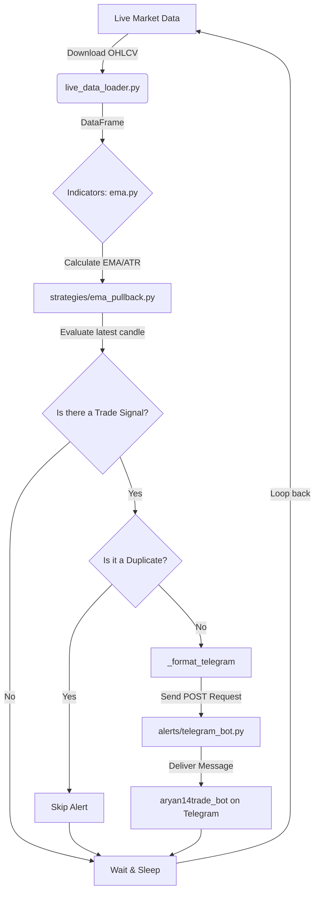

# Forward Test Engine (`forward_test_engine.py`)

Welcome to the plain-English, non-coder guide to the **Forward Test Engine**. 

If you've never written a line of code in your life, you are in the right place. This document will explain exactly what this file does, how it fits into the whole system, and what every single line of code means in simple terms.

---

## 1. System Architecture: Where Does This Fit?

In algorithmic trading, there are usually two main testing phases before you risk real money:
1. **Backtesting:** Looking at the *past* to see if a strategy would have made money.
2. **Forward Testing (Paper Trading):** Running the strategy in the *present* (live time), pretending to buy and sell with fake money to see if the strategy still works in real, unpredictable market conditions.

The `forward_test_engine.py` is the heart of the **Forward Testing** phase. 

### How It Works (The Blueprint)
Imagine the Forward Test Engine as a tireless robot sitting at a desk, watching the stock market tick by, and following a strict set of rules:

1. **Wake Up:** The robot wakes up every few seconds (e.g., every 10 seconds).
2. **Check the Price:** It grabs the very latest price data of the asset (like NVDA or Bitcoin).
3. **Do the Math:** It calculates the moving averages (EMAs) based on that new data.
4. **Consult the Strategy:** It asks the strategy rules: *"Should I buy or sell right now?"*
5. **Shout it Out:** If the strategy says "YES," the robot prints an alert on the screen and sends a message to your Telegram app on your phone.
6. **Go to Sleep:** The robot sleeps for a few seconds, then repeats the process. Forever.

---

## 2. Line-by-Line Code Explanation

Let's break the entire `forward_test_engine.py` file down into bite-sized pieces.

### Part 1: The Setup
```python
import time
import traceback
from datetime import datetime

from data.live_data_loader import load_live_data
from indicators.ema import calculate_ema
from strategies.ema_pullback import generate_signal
from alerts.telegram_bot import send_telegram_message
```
* **What this does:** 
  * `import` brings in helpful built-in tools. `time` is for making the robot sleep. `traceback` is for catching and explaining unexpected errors, and `datetime` is for knowing the current clock time.
  * The `from ... import ...` lines are the engine grabbing the other customized parts of our system (fetching data, doing math, reading the strategy, and knowing how to text you on Telegram).

```python
# Low value = fast feedback during debugging.  Set to 60 for 1-min bars in prod.
SLEEP_SECONDS = 10
```
* **What this does:** This sets the robot's "nap time." It tells the engine to wait 10 seconds between every time it checks the market. For live real-time trading, you'd usually wait a minute (60 seconds).

### Part 2: Preventing Spam (The Deduplicator)
```python
def _make_signal_key(signal: dict) -> tuple:
    return (
        signal["signal"],
        signal["type"],
        signal["strategy_id"],
        round(signal["entry"], 2),
    )
```
* **What this does:** Imagine the robot sees a "BUY" signal. Ten seconds later, it checks the market again and the signal is *still* "BUY". You don't want your phone buzzing every 10 seconds for the same trade! This little tool creates a unique "fingerprint" (the `signal_key`) for the trade using the direction, type, strategy number, and price. Later on, the robot will compare this fingerprint to the last one it saw so it knows if it’s a *new* trade or just the same old one.

### Part 3: Formatting the Alerts
```python
def _print_signal(signal: dict, config: dict) -> None:
    # ... code that organizes text on the screen ...
```
* **What this does:** When a trade triggers, this builds the pretty text that shows up on your computer screen. It takes all the raw data (like numbers) and puts it in a nice box with a timestamp and a green 🟢 or red 🔴 icon depending on whether we want to buy (LONG) or sell (SHORT).

```python
def _format_telegram(signal: dict, config: dict) -> str:
    # ... code that organizes text for Telegram ...
```
* **What this does:** Very similar to the above, but this formats the text specifically so it looks neat and easy to read when it pops up as a text message on your phone via Telegram. 

### Part 4: The Main Engine Loop (The Robot at Work)
```python
def run_forward_test(config: dict) -> None:
```
* **What this does:** This is the big boss command. When we turn the engine on, this is where everything starts. It takes in the `config` (your control panel settings).

```python
    ticker    = config["TICKER"]
    timeframe = config["TIMEFRAME"]
    ema_fast  = config["EMA_FAST"]
    ema_slow  = config["EMA_SLOW"]
```
* **What this does:** The engine reads your settings. It's asking and saving: "What asset are we trading?", "What timeframe?", and "What numbers am I using for the indicators?"

```python
    last_signal_key = None
    loop_count      = 0
```
* **What this does:** It prepares its memory. `last_signal_key` will eventually remember the fingerprint of the last trade it made, so it doesn't spam you. `loop_count` is just a tally counter of how many times the robot has checked the market.

```python
    print(f"\n[forward_test] 🚀 Starting live forward test for {ticker} ({timeframe})")
```
* **What this does:** It prints a neat little startup message on your screen so you know the engine is successfully turning on.

```python
    while True:
```
* **What this does:** This means "Do the following steps forever until someone forces the program to shut down." This creates the infinite, tireless loop.

```python
        loop_count += 1
        ts = datetime.now().strftime("%H:%M:%S")
        print(f"[{ts}] Loop #{loop_count} — fetching data for {ticker}…", end=" ", flush=True)
```
* **What this does:** For every loop round, it adds +1 to its tally counter, checks the clock (`ts`), and prints a "heartbeat" message so you know it hasn't frozen.

#### Step 1 & 2: Get Data and Do Math
```python
        try:
            # 1. Fetch and clean data
            df = load_live_data(ticker=ticker, interval=timeframe)
            
            # 2. Compute indicators
            df["ema_fast"] = calculate_ema(df, ema_fast)
            df["ema_slow"] = calculate_ema(df, ema_slow)
```
* **What this does:** The `try:` means "Try to run this code, but if anything breaks or the internet dies, don't panic, I have backup plans below." Then, it downloads the newest market data (`load_live_data`) and calculates the fast and slow moving lines using that data (`calculate_ema`). 

#### Step 3: Warm-up Period Check
```python
            # 3. Drop rows where indicators are NaN (warm-up period)
            df.dropna(subset=["ema_fast", "ema_slow"], inplace=True)

            if len(df) < 5:
                print("Not enough rows... skipping.")
                time.sleep(SLEEP_SECONDS)
                continue
```
* **What this does:** Moving averages require a little bit of historical data to figure out the math before they become accurate (this is the "warm-up"). This code throws away any lines that don't have enough history yet (`dropna`). Then, it asks: "Do I have at least 5 good lines of data left?". If the answer is no, it decides it's too risky to trade, goes to sleep, and tries again later.

#### Step 4 & 5: Strategy and Alerts
```python
            # 4. Evaluate strategy
            signal = generate_signal(df)
```
* **What this does:** It hands the fully prepped market data to your trading brain (the strategy). The strategy will output either a trade plan (a `signal`) or nothing (`None`).

```python
            # 5. Handle signal
            if signal:
                signal_key = _make_signal_key(signal)

                if signal_key != last_signal_key:
                    _print_signal(signal, config)
                    
                    try:
                        msg = _format_telegram(signal, config)
                        send_telegram_message(msg)
                    except Exception as tg_err:
                        print(f"Telegram send failed: {tg_err}")

                    last_signal_key = signal_key
                else:
                    print("Signal unchanged, skipping duplicate alert.")
```
* **What this does:** If the strategy says "We have a trade!" (`if signal:`):
  1. It creates the trade fingerprint (`signal_key`).
  2. It checks against its memory: Is this fingerprint different from the last one?
  3. If YES (it's completely new!): It prints the pretty text to your computer screen, and it *tries* to text your phone. If texting your phone fails for some reason (maybe Telegram is down), the engine will catch the error and keep running smoothly instead of crashing. Then it updates its memory with this new fingerprint.
  4. If NO (it's the exact same trade from 10 seconds ago!): It skips the alerts so it doesn't spam you.

```python
            else:
                print("No signal this bar.")
```
* **What this does:** If there was no trade from the strategy, it just prints that it found nothing, so you know it checked.

#### The Safety Nets
```python
        except ValueError as ve:
            print(f"Data error: {ve}")
        except KeyError as ke:
            print(f"Column error: {ke}")
        except Exception as exc:
            print(f"Unexpected error: {exc}")
```
* **What this does:** Remember the `try:` block earlier? This is an automated trading system, which means it runs while you're asleep. If the internet blips, or Yahoo Finance sends weird data, you do **not** want the entire program to crash and close. These chunks of code essentially say: "If any errors happen up above, catch them like a baseball, print out what went wrong, but keep the robot alive!"

```python
        # ── Wait before next iteration ─────────────────────────────────────
        time.sleep(SLEEP_SECONDS)
```
* **What this does:** At the very end of the loop, the robot goes to sleep for the 10 seconds we set at the top of the file. When 10 seconds are up, it jumps all the way back up to `while True:` and starts the whole checklist over again!

---

## 3. Technical Implementation Details

For the developers looking under the hood, here is how the Forward Test Engine works technically:

* **The Loop:** It relies on an infinite `while True:` loop inside Python, throttling itself with `time.sleep(SLEEP_SECONDS)` to ensure it does not exhaust API limits or CPU resources.
* **State Management:** It keeps state deliberately minimal. The only thing preserved across loops is the `last_signal_key`, a tuple consisting of `(signal_direction, signal_type, strategy_id, round(entry_price, 2))`. This acts as an idempotency key to prevent spam duplicates on consecutive loops -> basically used for data deduplication.
* **Error Handling:** Network requests and data parsing are wrapped in broad `try-except` blocks. If Yahoo Finance drops the connection or returns a `KeyError`/`ValueError` due to malformed dataset, the engine logs the traceback but continues to the next cycle. This guarantees uptime in an unpredictable live environment.
* **Loose Coupling:** The engine doesn't know *how* `calculate_ema` or `generate_signal` works. It simply honors the DataFrame contract. This allows you to completely swap out trading strategies without touching the engine logic.

---

## 4. Telegram Bot Implementation (`aryan14trade_bot`)

To receive real-time alerts without sitting in front of a computer, we integrated a custom Telegram bot. Here is exactly what was done to build it technically:

1. **Creating the Bot with BotFather:** We opened Telegram and searched for the official `@BotFather`.
2. **Registering the Name:** We sent the `/newbot` command and registered the bot under the handle **aryan14trade_bot**.
3. **Securing the Token:** BotFather replied with a unique HTTP API Token (the `BOT_TOKEN`), which acts as the password for the bot to communicate.
4. **Acquiring the Chat ID:** We sent a dummy message to `aryan14trade_bot` from the target chat group. By hitting the `https://api.telegram.org/bot<TOKEN>/getUpdates` API in our browser, we extracted the internal `CHAT_ID` of the conversation.
5. **Code Integration (`telegram_bot.py`):**
   * Using the `python-dotenv` package, we securely load the `TELEGRAM_BOT_TOKEN` and `TELEGRAM_CHAT_ID` from a hidden `.env` file so the credentials aren't pushed to GitHub.
   * We use the standard `requests` library to send an HTTP `POST` request to Telegram's `sendMessage` endpoint.
   * The text payload is styled using Telegram's native `Markdown` `parse_mode` to ensure cleanly formatted, bold text for our trade alerts.

---

## 5. System Architecture Diagram (Forward Testing)

Here is a visual representation of how data flows constantly during Forward Testing. 



